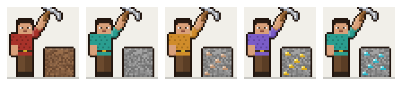

# savvy-progress-customized

Panel de subagentes para [Claude Code](https://claude.com/claude-code) con figuras animadas en pixel art. Muestra cada subagente con su modelo, contexto, tokens, costo estimado y tiempo, y lo dibuja como una cerveza que se llena o como un boxeador que entrena.

Es una copia endurecida de [savvy-progress](https://github.com/johnnyvizz/claude-kit/tree/main/plugins/savvy-progress) de johnnyvizz (MIT): solo observa, no da herramientas al modelo ni reescribe prompts.

**Trae tres temas, y se elige uno para todo el panel:** `boxeador` (por defecto), `cerveza` y `minero`, además de `cangrejo`, el dibujo original del autor. Ver [Cambiar de tema](#cambiar-de-tema).

**Tema `boxeador`** (por defecto)


**Tema `cerveza`**


**Tema `minero`**



## Instalar

En una sesión de Claude Code en la terminal:

```
/plugin install savvy-progress-customized --marketplace AcSsalazar/savvy-progress-customized
```

Desde una shell:

```
claude plugin install savvy-progress-customized --marketplace AcSsalazar/savvy-progress-customized
```

En la app de escritorio, donde `/plugin` no está disponible: botón **+** junto al cuadro del prompt → **Plugins** → **Add marketplace** con `AcSsalazar/savvy-progress-customized` → **Add plugin**.

## Uso

- **Barra sobre el prompt:** muestra el lote de subagentes en curso (`Agents · Tasks 2/3 · 67%`) con el relleno de píxeles del original. **×N** abre o cierra el panel con un clic; **✕** la oculta hasta que arranque otro subagente.
- `/agents-info` abre o cierra el panel; `/agents-info open` lo trae al frente. Se abre solo con cada lote nuevo de subagentes: si lo cierras, vuelve con el lote siguiente.

### Opciones

| Opción | Valores | Qué hace |
| --- | --- | --- |
| `estilo` | `boxeador` (defecto), `cerveza`, `minero`, `cangrejo` | Tema de las figuras (ver [Cambiar de tema](#cambiar-de-tema)). |
| `barra` | `si` (defecto), `no` | Muestra u oculta siempre la barra sobre el prompt. El panel sigue disponible con `/agents-info`. |
| `autoOpen` | `any` (defecto), `savvy`, `never` | `any`: el panel se abre solo con cada lote nuevo de subagentes; `savvy`: solo con trabajadores `savvy-*`; `never`: solo se abre con ×N o `/agents-info`. |
| `historial` | `sesion` (defecto), `lote` | `sesion`: el panel acumula todos los subagentes de la sesión, con Terminados plegable (como el original); `lote`: muestra solo el lote actual y empieza limpio con cada lote nuevo. |
| `language` | `auto` (defecto), `en`, `ru`, `he` | Idioma del panel. |

Todas se cambian igual que el tema, con `claude plugin configure`; las que no pongas conservan su valor. Por ejemplo, para apagar la barra:

```
cmd /c 'echo {"barra":"no"}| claude plugin configure savvy-progress-customized@savvy-progress-customized --values-stdin'
```
- El tema es uno para todo el panel: `cerveza` (por defecto), `boxeador` o `cangrejo`. Ver [Cambiar de tema](#cambiar-de-tema).

| Tema | Qué indica cada cosa |
| --- | --- |
| Cerveza | Recipiente = tipo de agente (Explore vaso, Plan pinta, general jarra, otro jarra tradicional). Cerveza = modelo (Haiku rubia, Sonnet roja, Opus negra, Fable dorada, otro trigo). Nivel: se llena rápido al principio y va frenando (unas 3 peticiones al modelo, media jarra); al terminar queda llena y desbordando, aunque la tarea haya sido corta; si falla queda vacía, gris y rajada. |
| Boxeador | Ejercicio = orden de llegada (cuerda, pera, saco, flexiones, abdominales, correr, pesas). Pantaloneta = modelo (Haiku verde, Sonnet azul, Opus morada, Fable dorada, otro gris). Banda = tipo de agente. ×N = peticiones al modelo. Suda con el contexto por encima del 70 %. |
| Minero | Bloque = modelo (Haiku piedra, Sonnet hierro, Opus oro, Fable diamante, otro tierra). Camisa = tipo de agente. Pica en bucle mientras trabaja; se queda quieto al terminar. |

Las animaciones duran 1 s por ciclo, se atan al reloj para seguir fluidas aunque el panel se redibuje cada segundo, y se detienen con `prefers-reduced-motion`.

## Cambiar de tema

El tema es la opción `estilo` del plugin y acepta `boxeador` (por defecto), `cerveza`, `minero` o `cangrejo`. Hay cuatro formas de cambiarlo:

1. **Con un comando, desde cualquier terminal** (también la terminal integrada de la app de escritorio). Es la más cómoda:

   En PowerShell o `cmd` (Windows):

   ```
   cmd /c 'echo {"estilo":"boxeador"}| claude plugin configure savvy-progress-customized@savvy-progress-customized --values-stdin'
   ```

   En bash o zsh (macOS, Linux, Git Bash):

   ```
   echo '{"estilo":"boxeador"}' | claude plugin configure savvy-progress-customized@savvy-progress-customized --values-stdin
   ```

   Responde `Configuration saved. Restart Claude Code to apply it.`: abre una sesión nueva o reinicia la app. Para ver el valor actual: `claude plugin configure savvy-progress-customized@savvy-progress-customized`.

   En Windows PowerShell no conviene usar `'{...}' | claude ...` directamente: suele mandar una marca BOM delante del texto y la CLI lo rechaza. Pasar por `cmd /c`, como arriba, lo evita.
2. **Al instalar desde la terminal:** después de elegir el alcance, Claude Code muestra las opciones del plugin. Ahí está **Estilo de las figuras**.
3. **Dentro de una sesión de Claude Code en la terminal** (escribe `claude` en la terminal, no en el chat de la app): `/config` → **Estilo de las figuras**, o `/plugin configure savvy-progress-customized@savvy-progress-customized`.
4. **Editando el archivo de configuración** a mano: `~/.claude/settings.json` (en Windows, `C:\Users\<tu-usuario>\.claude\settings.json`) y agrega dentro del objeto principal:

   ```json
   "pluginConfigs": {
     "savvy-progress-customized@savvy-progress-customized": {
       "options": { "estilo": "boxeador" }
     }
   }
   ```

   Si `pluginConfigs` ya existe, agrega solo la entrada del plugin. La clave es el nombre completo `plugin@marketplace`, el mismo que aparece en `enabledPlugins`. Si el panel no cambia, abre una sesión nueva.

Un valor distinto de `boxeador`, `cerveza`, `minero` o `cangrejo` se ignora y el panel vuelve a `boxeador`.

## Seguridad

- **Origen fijo:** `original/` es savvy-progress 1.2.1 tal cual, del commit `af8902c493f0a8db6be5e44bb74b567571f7824f`. No se instala desde el marketplace del autor, así que no cambia solo.
- **Endurecido:** se quitaron las herramientas `progress` y `step` y el párrafo que el original añadía al prompt de los subagentes `savvy-*`. Todos los hooks pasan el evento intacto (`next(e)`).
- **Capacidades:** reloj, su comando, su panel, su propio estado, leer la configuración (solo usa `language`) y `LANG`/`LC_ALL`/`LC_MESSAGES`. Sin red, archivos, procesos, modelos, telemetría ni herramientas. Los dibujos son SVG generados por código: sin scripts ni recursos externos.
- **Receta verificable:** `herramientas/endurecer.py verificar` rehace los archivos del plugin a partir de `original/` con reemplazos exactos y comprueba que coinciden byte a byte.
- **Guardia:** `plugin/verificar.ps1` falla si un archivo no coincide con `plugin/huellas.sha256`, si aparece código de red, `eval` o `import()`, o si el validador de Claude Code reporta eventos, llamadas, hosts o telemetría fuera de la lista permitida.

Límite: la guardia protege contra cambios no revisados (una actualización, una copia equivocada); quien pueda editar la carpeta también puede editar las huellas.

## Estructura

```
plugin/                 el mod que se instala
  hooks/register.tsx    código del original con los cambios de la receta
  hooks/estilos.ts      temas en pixel art (cerveza y boxeador)
  hooks/*.test.ts       pruebas (costo y contexto del autor, seguridad, estilos)
  verificar.ps1         guardia; huellas.sha256 sus huellas
original/               savvy-progress 1.2.1 sin cambios, para auditar
herramientas/           endurecer.py (receta) y vista.mjs (genera docs/*.gif)
.claude-plugin/         marketplace.json
```

## Desarrollo

```
claude plugin validate plugin
claude plugin test plugin
python herramientas/endurecer.py verificar
node herramientas/vista.mjs
powershell -NoProfile -ExecutionPolicy Bypass -File plugin/verificar.ps1
```

`vista.mjs` necesita Node 23.6 o más reciente (ejecuta `estilos.ts` directamente). Para probar el mod sin instalarlo: `claude --plugin-dir plugin`.

## Créditos y licencia

MIT. El código original, el panel y los cangrejos son de johnnyvizz ([claude-kit](https://github.com/johnnyvizz/claude-kit)). Los cambios de seguridad y los temas cerveza y boxeador son de AcSsalazar. Ver `LICENSE`.
