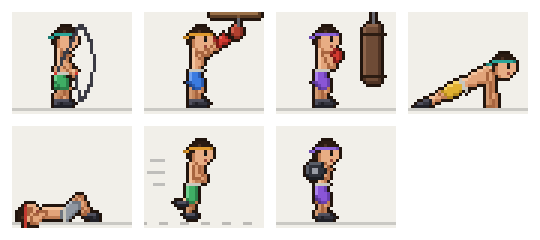

# savvy-progress-customized

Panel de subagentes para [Claude Code](https://claude.com/claude-code) con figuras animadas en pixel art. Muestra cada subagente con su modelo, contexto, tokens, costo estimado y tiempo, y lo dibuja como una cerveza que se llena o como un boxeador que entrena.

Es una copia endurecida de [savvy-progress](https://github.com/johnnyvizz/claude-kit/tree/main/plugins/savvy-progress) de johnnyvizz (MIT): solo observa, no da herramientas al modelo ni reescribe prompts.




## Instalar

En una sesión de Claude Code en la terminal:

```
/plugin install savvy-progress-customized --marketplace AcSsalazar/savvy-progress-customized
```

Desde una shell:

```
claude plugin install savvy-progress-customized --marketplace AcSsalazar/savvy-progress-customized
```

En la app de escritorio, donde `/plugin` no está disponible: botón **+** junto al cuadro del prompt → **Plugins** → **Add marketplace** con `AcSsalazar/savvy-progress-customized` → **Add plugin**.

## Uso

- `/agents-info` abre o cierra el panel; `/agents-info open` lo trae al frente. Se abre solo cuando empieza un subagente.
- En `/config`, **Estilo de las figuras** elige el tema de todo el panel: `cerveza` (por defecto), `boxeador` o `cangrejo` (el dibujo original del autor).

| Tema | Qué indica cada cosa |
| --- | --- |
| Cerveza | Recipiente = tipo de agente (Explore vaso, Plan pinta, general jarra, otro jarra tradicional). Cerveza = modelo (Haiku rubia, Sonnet roja, Opus negra, Fable dorada, otro trigo). Nivel = peticiones al modelo, 5 % cada una. Al terminar se desborda; si falla queda vacía, gris y rajada. |
| Boxeador | Ejercicio = orden de llegada (cuerda, pera, saco, flexiones, abdominales, correr, pesas). Pantaloneta = modelo (Haiku verde, Sonnet azul, Opus morada, Fable dorada, otro gris). Banda = tipo de agente. ×N = peticiones al modelo. Suda con el contexto por encima del 70 %. |

Las animaciones duran 1 s por ciclo, se atan al reloj para seguir fluidas aunque el panel se redibuje cada segundo, y se detienen con `prefers-reduced-motion`.

## Seguridad

- **Origen fijo:** `original/` es savvy-progress 1.2.1 tal cual, del commit `af8902c493f0a8db6be5e44bb74b567571f7824f`. No se instala desde el marketplace del autor, así que no cambia solo.
- **Endurecido:** se quitaron las herramientas `progress` y `step` y el párrafo que el original añadía al prompt de los subagentes `savvy-*`. Todos los hooks pasan el evento intacto (`next(e)`).
- **Capacidades:** reloj, su comando, su panel, su propio estado, leer la configuración (solo usa `language`) y `LANG`/`LC_ALL`/`LC_MESSAGES`. Sin red, archivos, procesos, modelos, telemetría ni herramientas. Los dibujos son SVG generados por código: sin scripts ni recursos externos.
- **Receta verificable:** `herramientas/endurecer.py verificar` rehace los archivos del plugin a partir de `original/` con reemplazos exactos y comprueba que coinciden byte a byte.
- **Guardia:** `plugin/verificar.ps1` falla si un archivo no coincide con `plugin/huellas.sha256`, si aparece código de red, `eval` o `import()`, o si el validador de Claude Code reporta eventos, llamadas, hosts o telemetría fuera de la lista permitida.

Límite: la guardia protege contra cambios no revisados (una actualización, una copia equivocada); quien pueda editar la carpeta también puede editar las huellas.

## Estructura

```
plugin/                 el mod que se instala
  hooks/register.tsx    código del original con los cambios de la receta
  hooks/estilos.ts      temas en pixel art (cerveza y boxeador)
  hooks/*.test.ts       pruebas (costo y contexto del autor, seguridad, estilos)
  verificar.ps1         guardia; huellas.sha256 sus huellas
original/               savvy-progress 1.2.1 sin cambios, para auditar
herramientas/           endurecer.py (receta) y vista.mjs (genera docs/*.gif)
.claude-plugin/         marketplace.json
```

## Desarrollo

```
claude plugin validate plugin
claude plugin test plugin
python herramientas/endurecer.py verificar
node herramientas/vista.mjs
powershell -NoProfile -ExecutionPolicy Bypass -File plugin/verificar.ps1
```

`vista.mjs` necesita Node 23.6 o más reciente (ejecuta `estilos.ts` directamente). Para probar el mod sin instalarlo: `claude --plugin-dir plugin`.

## Créditos y licencia

MIT. El código original, el panel y los cangrejos son de johnnyvizz ([claude-kit](https://github.com/johnnyvizz/claude-kit)). Los cambios de seguridad y los temas cerveza y boxeador son de AcSsalazar. Ver `LICENSE`.
